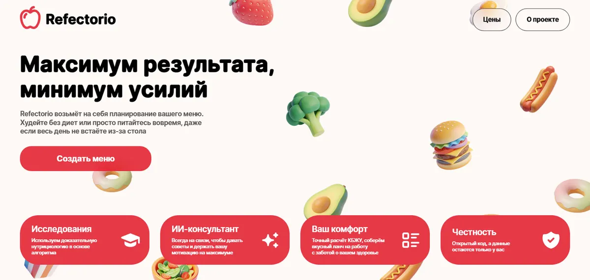
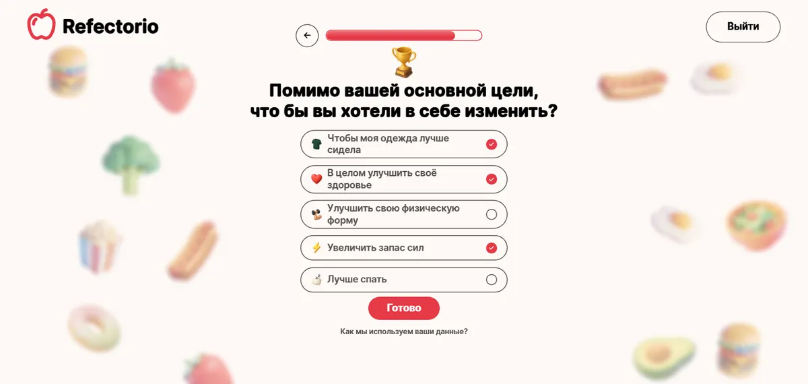
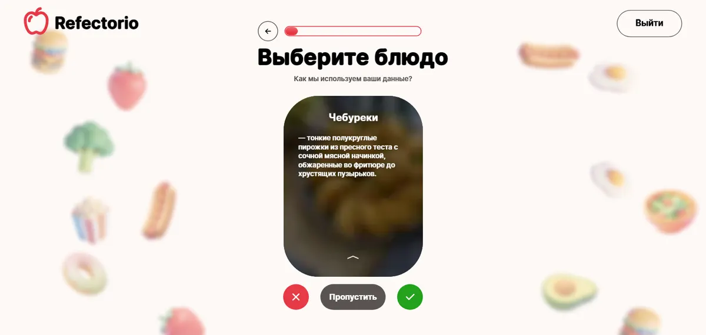
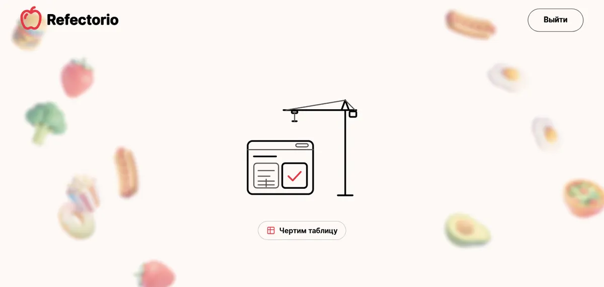
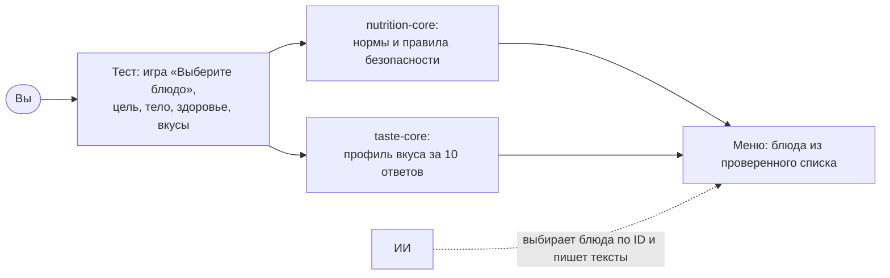

# Refectorio

**Сайт-постановщик целей в питании с ИИ.** Вы выбираете цель — сбросить вес, набрать мышцы или удержать форму, —
проходите короткий тест о себе и своих вкусах, а Refectorio собирает меню с научным расчётом норм.

Школьный проект команды **Modern Manifesto** (школа #2107). Бесплатный, с открытым исходным кодом.
Название — от латинского *refectorium*, «трапезная».

**Сайт:** https://refectorio.onrender.com

| Главная | Тест |
|---|---|
|  |  |
| **Игра «Выберите блюдо» с описанием** | **Генерация меню** |
|  |  |

## Как это работает



## Принципы

- **Наука, а не догадки.** Калории, белки, жиры, углеводы и нормы считает проверяемый код по научным источникам
  ([наука простым языком](docs/science/)).
- **ИИ не считает цифры.** ИИ только выбирает блюда из заранее отфильтрованного списка и пишет тексты; при сбое работает
  алгоритм без ИИ.
- **Безопасность.** Для детей, беременных и кормящих, людей с диабетом, болезнями почек и расстройствами пищевого
  поведения функции ограничены, и сайт советует обратиться к врачу. Refectorio не ставит диагнозы и не заменяет врача.
- **Приватность.** Ответы теста хранятся только в вашем браузере (`localStorage`) и никуда не отправляются.

## Этапы

| Этап | Что | Состояние |
|---|---|---|
| 0 | Исследование, архитектура, дизайн-система, фундамент | готово |
| 1 | Главная страница | готово |
| 2 | Интерактивный тест: игра «Выберите блюдо», вопросы о цели и здоровье, финал | готово |
| 3 | Доработка по отзывам команды: «Цены», карточка проекта, новый вопрос, описание блюд в игре, новая анимация генерации, подгонка под любые экраны | готово, кроме цифр КБЖУ блюд (считаются) |
| 4 | Генерация меню, ИИ-помощник, аккаунты | впереди |

Что менялось для пользователей — в [`CHANGELOG.md`](CHANGELOG.md).

## Запуск у себя

Нужны Node.js 24 LTS и npm 11.

```bash
npm ci          # установка зависимостей
npm run dev     # сайт на http://localhost:5173
npm test        # юнит-тесты
npm run build   # сборка
```

Все команды — в [`CLAUDE.md`](CLAUDE.md), правила работы — в [`CONTRIBUTING.md`](CONTRIBUTING.md).

## Структура

| Папка | Что внутри |
|---|---|
| `apps/web` | сайт: Vite + React + TypeScript + Tailwind CSS + Motion; тест — `src/features/quiz` |
| `packages/nutrition-core` | расчёт норм питания и правила безопасности, с тестами |
| `packages/taste-core` | каталог блюд, модель вкуса, отбор карточек игры, описания блюд ([README](packages/taste-core/README.md)) |
| `packages/contracts` | общие схемы данных: ответы теста, профиль вкуса ([README](packages/contracts/README.md)) |
| `assets-src` | исходные картинки; `npm run assets` делает из них AVIF/WebP |
| `docs` | документация — [оглавление](docs/README.md) |
| `scripts` | служебные скрипты: фото блюд, иконки, рисунки анимации генерации (`npm run story`), расчёт КБЖУ блюд |

## Технологии

Vite 8 · React 19.3 · TypeScript 6 · Tailwind CSS 4.3 · Motion 13 · Canvas 2D · Open Runde · Tabler Icons · zod ·
Vitest · Playwright · Lighthouse CI. Хостинг — Render Static Site.

## Команда

Modern Manifesto, школа #2107: Старостин Михаил, Малютин Артём, Устименко Милана, Ясинский Алексей, Щербюк Анна.

## Лицензия

Код — [MIT](LICENSE). Шрифт Open Runde (скруглённый Inter) — SIL Open Font License 1.1. Иконки Tabler — MIT.
Иллюстрации еды, иконки теста и макеты — © команда Modern Manifesto ([`assets-src/README.md`](assets-src/README.md)).
Фото блюд — с [Unsplash](https://unsplash.com/?utm_source=refectorio&utm_medium=referral); в репозитории их нет, сайт
собирает копии при сборке ([авторы](docs/photo-credits.md), [правила](docs/photo-licensing.md)).
