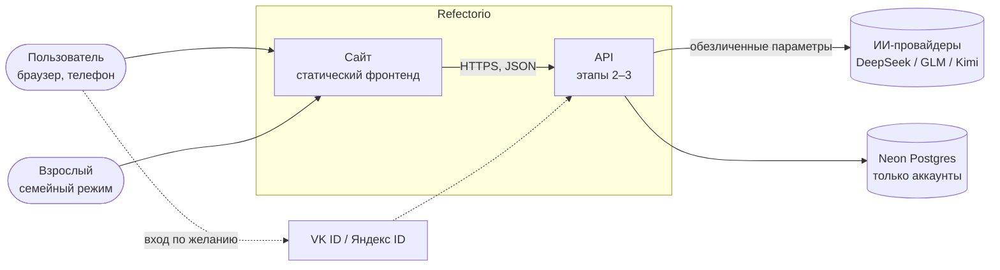
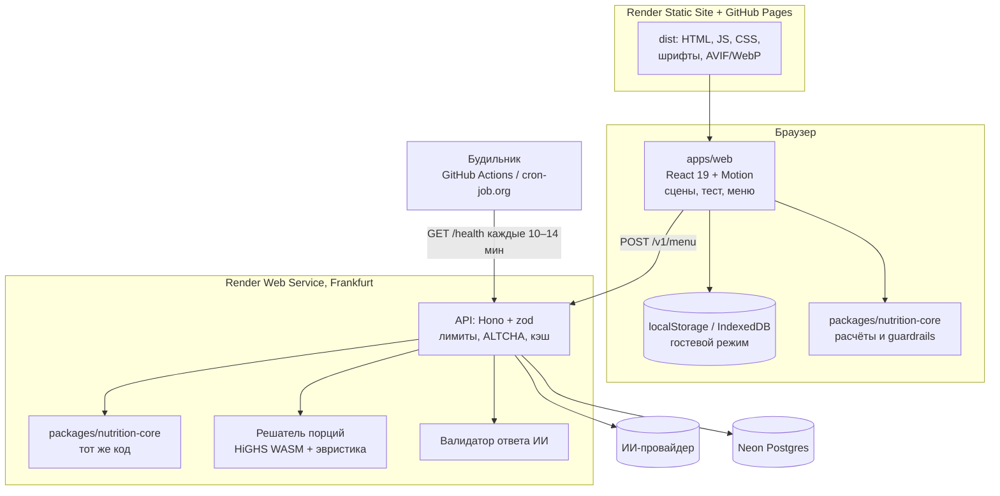
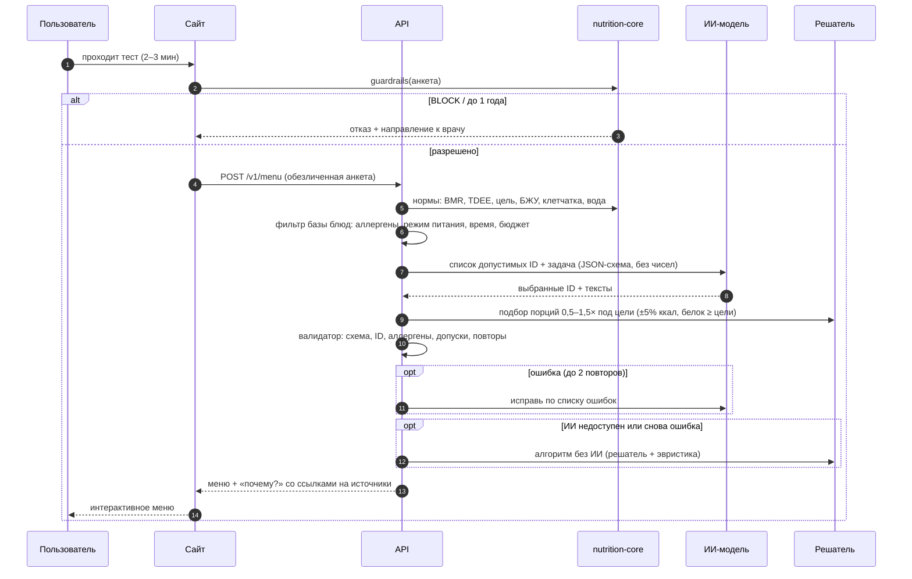
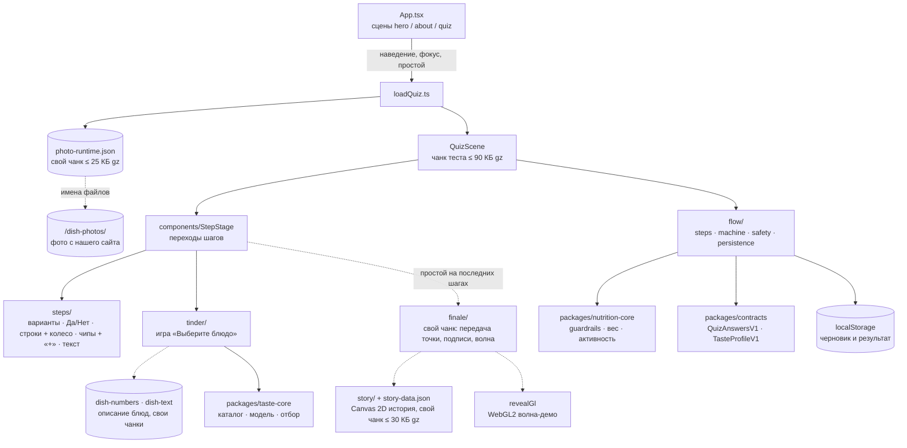
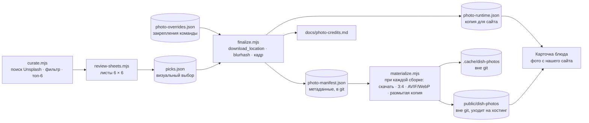

# Архитектура Refectorio

Решения — в `docs/adr/` (0001–0010). Черновики этапов 2–3: модель данных — `docs/drafts/data-model.md`,
контракт API — `docs/drafts/openapi.yaml`.

## 1. Контекст системы



## 2. Контейнеры



Один и тот же пакет `nutrition-core` работает и в браузере (живой расчёт в тесте), и на сервере (меню) — числа одинаковы везде.

## 3. Поток генерации меню



## 4. Тест «Создать меню» (этап 2)

Тест открывается по «Создать меню» (адрес `#quiz`) поверх главной: главная становится `inert`, летающая еда
размывается и замедляется. Весь код теста — ленивые чанки, главная от него не тяжелеет.



- **Поток — данные.** `flow/steps.ts` перечисляет шаги (id, вид, `showIf(ответы)`, проверка), `flow/machine.ts` —
  чистый редьюсер (ответ, «Назад», отмена карточки, переход), `flow/safety.ts` сверяет ответы с guardrails
  (`nutrition-core`) и решает, какие уведомления показать и что поменять (например, цель «похудение» при диабете
  2 типа → «поддержка»). Всё это — чистые функции с юнит-тестами.
- **История браузера.** Каждый ответ в игре и каждый шаг — отдельная запись, поэтому системная кнопка «Назад»
  работает как «Вернуться» (D-039). Глубина считается из состояния (`historyDepth`), откат на n шагов — `rewind`.
- **Хранение.** Черновик — `localStorage['refectorio.quiz.v1']` (версия, проверка zod при чтении, срок 30 дней,
  испорченный — тихо забывается), результат — `refectorio.quiz.result.v1`. На сервер ничего не уходит (ADR 0003).
- **60 fps — вне React.** Перетаскивание карточки, физика колеса, морфы панелей и холст генерации живут в refs и motion values;
  в состоянии React — только ответы и экран.
- **Генерация (этап 3, ADR 0012).** История из линейных рисунков на Canvas 2D: рисунки разворачиваются в точки при
  сборке (`scripts/story`, `npm run story`), сцены двигают свои части матрицами, превращения — облака точек на дугах,
  временная шкала с юнит-тестами, подписи по меткам сцен. Притяжения еды больше нет.
- **Описание блюд (этап 3, D-056).** Касание или свайп вниз открывает на карточке описание и (когда будут посчитаны)
  калории и БЖУ стандартной порции: цифры — `taste-core/data/dish-numbers.json` (считает скрипт по рецептам и USDA,
  `scripts/dish-data`), тексты — `dish-text.json`, грузятся в простое после первой карточки.
- **Безопасность ввода.** Свободный текст (нелюбимые продукты, «Что нам следует знать?», свои пункты чипов) хранится
  отдельно от словарных значений и ограничен по длине (`INPUT_LIMITS`); на этапе 3 он считается непроверенными
  данными (R11).

## 5. taste-core: как игра узнаёт вкус за 10 ответов

```mermaid
flowchart LR
  catalog[(catalog.json<br/>186 блюд, признаки)] --> features[features.ts<br/>разреженные векторы]
  features --> model[model.ts<br/>пробит-модель, гауссов априор,<br/>ADF-обновление]
  model --> selection[selection.ts<br/>BALD × P(ответ) + правила]
  selection --> engine[engine.ts<br/>сессия: replay, peek, undo,<br/>скрытые блюда]
  engine --> profile[profile.ts<br/>TasteProfileV1: вероятности, подсказки]
  sim[sim/<br/>5000 синтетических игроков] -. "проверка" .-> selection
```

- Сессия детерминирована: seed + решения → те же карточки, поэтому черновик восстанавливается повтором ответов.
- Блюда без подобранного фото игра не показывает (`hidden`), но их вероятность «понравится» всё равно считается.
- Подробности и альтернативы — ADR 0008; итоги симуляции — `refectorio-workspace/reports/stage-2/taste-sim/` (D-035).

## 6. Фото блюд



- Ключи читают только скрипты (переменная окружения или `.secrets/` вне git); сайт к API не обращается.
- Фото раздаёт наш сайт (ADR 0011, D-048): `materialize.mjs` собирает их при каждой сборке, имена файлов
  (`<провайдер>-<id>-f<x>x<y>-v<версия>-<ширина>`) браузер строит сам по `photo-runtime.json`. Повторная сборка без
  изменений пропускается по хэшу манифеста; сборка для публикации падает, если не хватает больше 5 % фото.
- Цепочка на карточке: наше фото → заглушка из blurhash с названием блюда. Файлов фото в git нет — правила в
  `docs/photo-licensing.md`. Флаг `PHOTO_HOSTING=unsplash` возвращает хотлинк с подписью этапа 2.
